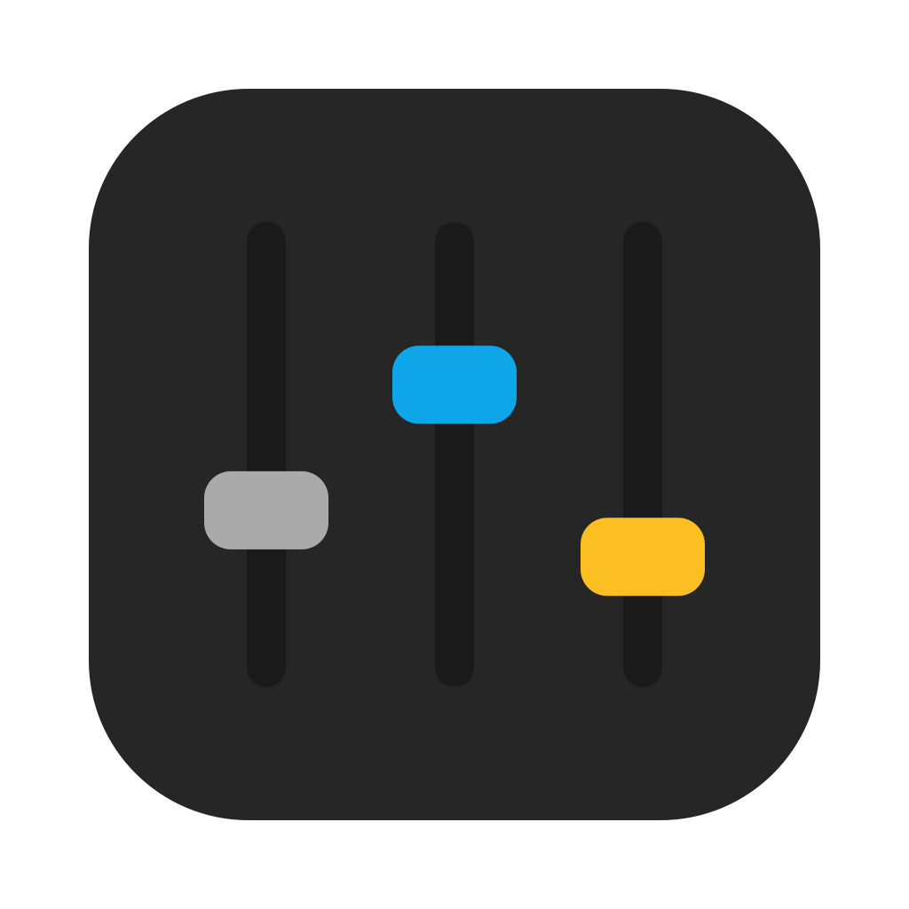

# csSETTINGS

  

**Community Shaders preset picker for Skyrim on Mac (CrossOver) — browse, apply, back up and restore presets.**

🇬🇧 English · 🇫🇷 [Français](#français)

## About

csSETTINGS manages the Community Shaders presets of a Skyrim bottle running under CrossOver: browse, apply, back up and restore. Made by **Starbudweiser & Claude Code (Anthropic)**. MIT License, © 2026 Starbudweiser. Provided as is, without warranty of any kind. Not affiliated with the Community Shaders authors or with Nexus Mods. In the app: **csSETTINGS › About csSETTINGS**.

🍏 **Native Mac app written in Swift, signed and notarized by Apple.**

csSETTINGS manages the Community Shaders (Bottled Shaders) presets of a Skyrim bottle running under CrossOver. It is part of the Skyrim Tools family of native macOS apps: <https://starbudweiser.github.io/skyrim-tools/>

## Features

- **Preset library**: keep all your presets in one place and apply one in a click.
- **Safe changes**: an automatic backup is made before every apply, and any state can be restored.
- **Import**: add presets from archives or folders.
- **Nexus Mods**: download presets from Nexus Mods inside the app (a Premium account and your API key are required; the key is stored in the macOS Keychain, never in a file).
- **Shader systems**: switch between Community Shaders and ENB with checked backups.
- **Automatic updates**: once a day the app checks GitHub for a new release, shows what changed and installs it (checksum, Developer ID signature and notarization verified), never while a task is running. Settings › Updates: *Install updates automatically* and *Check now*.

### What's new in 2.0.0

- Rewritten as a native Swift app (no more Python/PyQt/PyInstaller): same features, same texts in four languages, same look.
- Signed with a Developer ID and notarized by Apple: macOS opens the app without a security warning.

## Install

**[Download the latest notarized release](https://github.com/starbudweiser/csSETTINGS/releases/latest)**, unzip it and move csSETTINGS to your Applications folder. Apple Silicon Mac, **macOS 15 Sequoia** or later. No Python needed.

## Build

Requires Xcode (Swift 6): `./build_app.sh` builds `csSETTINGS.app` (tests included, `swift test --package-path macos`).

## Languages

English, French, Spanish and Italian. The app follows your Mac's preferred language automatically (English if it is none of these four).

## Support

💬 Help and community: [Skyrim Mac Toolkit Discord](https://discord.gg/jRS4rvynx6) · bug reports: [GitHub Issues](https://github.com/starbudweiser/csSETTINGS/issues).

## License

Released under the **MIT License**, © 2026 Starbudweiser. See [LICENSE](LICENSE).

---

## Français

**Sélecteur de presets Community Shaders pour Skyrim sur Mac (CrossOver) — parcourir, appliquer, sauvegarder et restaurer.**

🍏 *Appli Mac native écrite en Swift, signée et notarisée par Apple.*

💬 Aide et communauté : [Discord du Skyrim Mac Toolkit](https://discord.gg/jRS4rvynx6)

### À propos

csSETTINGS gère les presets Community Shaders (Bottled Shaders) d'une bouteille Skyrim sous CrossOver. L'appli fait partie de la famille Skyrim Tools, des applis macOS natives : <https://starbudweiser.github.io/skyrim-tools/>

### Ce qu'elle fait

- **Bibliothèque de presets** : tous vos presets au même endroit, appliqués en un clic.
- **Changements sûrs** : sauvegarde automatique avant chaque application, restauration possible à tout moment.
- **Import** : ajoutez des presets depuis des archives ou des dossiers.
- **Nexus Mods** : téléchargez des presets depuis l'appli (compte Premium et clé d'API requis ; la clé est gardée dans le Trousseau macOS, jamais dans un fichier).
- **Systèmes de shaders** : passez de Community Shaders à ENB, avec des sauvegardes vérifiées.
- Interface en **anglais, français, italien et espagnol** (suit la langue de votre Mac).
- **Mises à jour automatiques** : une fois par jour, l'appli cherche une nouvelle version sur GitHub, montre les nouveautés et l'installe (somme de contrôle, signature Developer ID et notarisation vérifiées), jamais pendant un traitement. Réglages › Mises à jour : *Installer automatiquement les mises à jour* et *Rechercher maintenant*.

### Nouveautés de la 2.0.0

- Réécrite en appli Swift native (plus de Python, de PyQt ni de PyInstaller) : mêmes fonctions, mêmes textes dans les quatre langues, même aspect.
- Signée avec un certificat Developer ID et notarisée par Apple : macOS ouvre l'appli sans avertissement de sécurité.

### Installation

Téléchargez la dernière version sur la page [Releases](https://github.com/starbudweiser/csSETTINGS/releases/latest), décompressez-la et déplacez csSETTINGS dans Applications. Mac Apple Silicon, macOS 15 Sequoia ou plus récent. Python n'est pas nécessaire.

### Compiler depuis les sources

Xcode (Swift 6) requis : `./build_app.sh` produit `csSETTINGS.app` (tests compris, `swift test --package-path macos`).

### Licence

MIT
